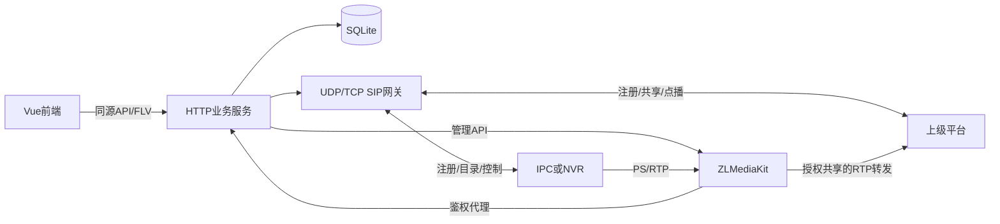

# 前后端工作流与接口 v0.7

以下描述当前实现，未来能力明确列在末尾。WVP仅作行为参考，业务后端与Vue前端独立开发。

## 架构与职责

角色权限的本轮实现、接口、迁移及未完成验证见[角色与权限](roles-and-permissions.md)。角色控制功能，账号控制设备范围；服务端每次及持续传输均检查授权，前端接收会话通知同步菜单，并保留定期刷新降级路径。不将仅隐藏按钮视为权限实现。

用户资料保留原账号、密码与角色模型，迁移 11 新建 `user_profiles`，关联用户并级联删除。资料字段为姓名 `displayName`、部门 `department`、职务 `jobTitle`、电话 `phone`、邮箱 `email`、备注 `remark`；均可留空。创建/最近登录时间来自真实写入或既有审计，无法追溯的历史时间为空。`GET /users` 与管理员 `GET /users/{id}` 返回脱敏资料；`POST /users` 可带 `profile`，管理员 `PUT /users/{id}/profile` 与登录用户 `PUT /me/profile` 更新资料，须 CSRF 和资料 `version`，旧版本返回 409。资料接口不能修改账号、角色、密码、时间或其他用户归属。个人中心与用户管理共用资料字段、服务端校验和持久化结果，更新记录审计但不把联系方式写入审计。

接入配置的管理员可发起 `POST /api/v1/system/restart`，须有效登录、CSRF 和 `confirm: true`。返回 202 仅表示受理，同一实例上的重复请求只受理和审计一次。`npm start` 的运行管理器按顺序回收平台资源并重建服务，加载已保存接入配置；操作系统进程和外部媒体节点不重启。浏览器以 `/api/health` 的新 `instanceId` 和 `status=ok` 确认完成，最长等待 90 秒，失败或超时明确提示。SIP 启动失败仍保留 HTTP 配置入口，健康状态为 `degraded`，允许修正后再次重启。重启会产生预览中断和录像空档，已启用录像计划按现有计划恢复逻辑接续；未保存编辑不会生效。直接嵌入 `createServer()` 而未提供重启回调时，配置返回 `runtime.restartAvailable=false`，重启接口返回 503。

- Vue 3 + TypeScript + Vite：设备、实时监控、录像、级联、用户/审计/配置页面。
- Node.js 24原生HTTP：登录/CSRF/角色、业务路由；录像/云台/级联通过独立服务，不在前端拼装信令。
- SIP模块：UDP/TCP注册、Digest、XML解码、请求事务和对话；响应按来源、Call-ID、CSeq与Via分支关联。
- 媒体适配器：ZLMediaKit管理API、RTP接收/转发/回收、暂停超时保护、同源WebSocket-FLV及HTTP-FLV代理。
- SQLite：迁移、设备/通道、账号/会话、源流/观看者、录像任务/条目、PTZ命令、上级平台/共享/对话、审计。

## 设备与直播

告警原图重分析修正已正式加载（验收记录见qwen-alarm-quality-20261108.md）：`POST /ai/alarm-analyses`增加可选布尔`reanalyze`。显式请求可将已有终态分析重新入队，同一分析ID与原图时间不变，旧结果在受理后清空，进行中重复请求只返回当前任务。要求原有AI/告警/设备权限及原分析所有者或管理员身份，原归属账号仍须有设备分析权限。新推理跳过精确及相近画面缓存；队列上限、超时、资源等待、撤权和取消继续生效。不会重新抓图或控制摄像机。告警详情终态记录显示“重新分析原图”，受理后展示排队/运行，成功才显示新结果。

告警Qwen自动分析沿用AI分析记录：迁移21的alarm_ai_jobs以snapshotId唯一关联ai_jobs和源告警。模型设置新增qwenAlarmEnabled、qwenAlarmIntervalSeconds（120～3600秒，默认120）；启用操作者在服务端保存为任务归属账号，不接受客户端指定归属，权限在入队、运行和发布结果时复核。默认关闭，启用后只自动采样新图；POST /ai/alarm-analyses（alarmId）可显式提交已有告警图，要求ai.analyze、alarms.view及当前设备范围。队列最多5项、全局单任务、两次启动至少60秒、排队15分钟超时；每通道自动采样按图片时间间隔，避免稍后补分析同一密集告警。抓图共用同一snapshotId时只生成一条分析记录。

Qwen独立于DeepSeek开关和密钥，只使用已有JPEG；Windows CPU运行库默认2线程、低优先级，进程每次完成释放；启动需3584MiB可用内存，运行低于1GiB或进程工作集高于2800MiB取消并等待，超时120秒。默认在2项活动录像、4个观看租约或其他AI工作时等待；不创建/关闭视频源，不调用SIP或云端服务。结果保存原图片时间、中文描述、清洗标签、原告警关联，在画面分析列表和既有分析画面关键词检索中可查，均按AI权限和当前设备分组校验。模型停用、任务取消、权限撤销、关闭和异常有取消回收路径，重启可恢复15分钟内中断的本地任务。图片/结果按既有AI记录保留期清理；告警详情的分析结果也遵守AI访问权限，不向仅有告警权限的账号泄露。

队列优先级补充：Qwen让位于正在进行的历史录像检索，历史检索只让位于普通AI排队任务，不能反向等待Qwen排队项，避免互相等待。模型设置页只展示已经安装的本地模型；模型清单仅保留Chinese-CLIP及千问。YOLO功能已退役，迁移22删除其派生检测缓存，不删除分析记录与录像。

Qwen当前默认640像素/256～512图像token/224输出token、2048上下文、64微批，使用JSON约束输出最多5项可见物体的名称、颜色、位置，再生成既有summary/tags；不提供目标框、置信度或精确计数。提示不预填人车答案，模型版本640:p6i1:t2隔离旧缓存。默认2线程低优先级、限定CPU范围；全局仍只运行一个本地告警任务，单线程备用配置仍用4项录像/9租约门槛。历史结果只在用户显式重分析时改写。原图重复推理、无车对照、正式原告警约36秒结果及运行检查见qwen-alarm-quality-20261108.md；384像素旧版速度记录仅作历史参考。

移动侦测（AlarmMethod=5、AlarmType=2）入库后异步抓图，避免阻塞SIP应答。只读取该设备/通道已有且ready的live源，不发送新INVITE、不创建/停止观看者，不修改录像或预览源；无可用源则明确跳过。全实例最多1个抓图，10秒超时，单通道30秒内事件共享图；FFmpeg单线程、JPEG最长边960、上限512KiB。迁移20增加独立图片与告警关联表，保存7天/500张/100MiB，过期关联明确显示已清理，不补拍历史事件。GET /alarms/:id返回snapshot元数据；GET /alarms/:id/snapshot须alarms.view及当前设备范围权限，图片no-store，不回传媒体管理地址或密钥。ALARM_SNAPSHOT_ENABLED=0可停用抓图。请求受理、就绪、失败、跳过与过期分别展示，图片为平台接到通知附近的画面，不冒充摄像机事件原图。

告警接入补充显式国标布防：`POST /devices/:id/subscriptions/Alarm/guard`，需要`subscriptions.manage`、CSRF及设备分组权限。返回202和任务只表示受理；订阅列表每条告警配置的`guard`显示最新任务与协议阶段，只有匹配设备/SN/DeviceID的DeviceControl业务Response Result=OK才成功。每设备合并进行中请求、最多8项、12秒超时、关闭/重启标记结果未知。命令为GB28181 GuardCmd=SetGuard，不自动撤防、不改变移动侦测区域或视频配置；是否产生真实告警另行验收。告警订阅显式携带级别1至4和AlarmMethod=0，不把未携带可选字段描述为标准错误。

AI模型配置补充只读 `GET /api/v1/ai/settings/local-models`，沿用服务端 `ai.configure` 管理权限。返回本地模型名称、用途、文件存在状态、默认检索选择、权重大小和离线测试摘要，不返回本地路径、密钥或图片。枚举不加载模型、不联网下载。文件已安装、检索默认选择与离线测试通过分别展示。失败显示读取错误，不替换为虚假的已安装状态。

实时播放器记录点播时的平台实例。发生断流后，普通设备错误且平台实例未变时保留失败提示；若检测到健康的新平台实例，则重新申请独立观看者并保留所选码流、声音和画面比例。检测最长 90 秒，多窗口共享并发健康请求。权限错误不自动重试，设备录像回放不自动重播；切换码流或卸载窗口取消检测并按播放代次处理迟到响应。

管理员创建档案并单独设置凭据；未知设备拒绝注册。已认证注册、心跳、通道状态、媒体就绪分别判断。目录同步按设备/SN合并分批结果；完整后才替换旧目录，失败保留旧通道。

前端创建观看者后立即得到202与sessionId/viewerId，并轮询状态。后端依次分配RTP、INVITE/ACK、等待媒体注册，然后开放同源流代理；SIP 200不代表视频可播放。生命周期为allocating→inviting→waiting_media→ready→stopping→stopped/failed。

相同直播源可复用，但每位观看者独立续租和退出；回放不复用源流。前端每15秒续租45秒租约。只按用户权限开放状态和媒体；退出登录清理该登录创建的观看者。最后引用释放后结束设备对话并回收RTP；分配中取消、迟到响应、失败补偿、重启残留均有清理路径。

实时监控支持1/4/9/16/25/36画面，均为方形布局，8画面按用户要求取消。先选窗口再选通道；单画面保留所选通道，缩小布局卸载多余播放器并释放观看者，窄屏保留窗口数并在画面区域横向滚动。单账号最多64个观看者、全局最多64个未释放源流，均为开发保护阈值。

实时预览不显示浏览器原生播放控件和进度条；自定义工具栏支持主/子码流、声音开关、放大还原、全屏及设置。设置含音量、截图下载、重新连接、画面比例和实际视频/音轨信息。小窗口通过设置入口选择码流。录像回放继续使用平台的暂停、倍速和跳转控件。

双击多画面中的视频放大，重复双击或Esc还原；通过CSS隐藏其余窗口，不卸载播放器、改动槽位或释放其他观看者。单画面双击切换全屏，全屏内双击退出。进入新布局时退出放大状态。

直播POST接受`streamNumber=0/1`（省略为主码流），SDP携带`a=streamnumber`。只有通道及码流参数一致才共享源流；主码流使用旧null配置保持兼容，子码流保存`{kind:'live',streamNumber:1}`。切换/重连先释放本窗口观看者，迟到点播只回收自身租约，不覆盖新的连接；其他观看者不受影响。

浏览器默认静音，识别实际音轨后可开启声音并调音量；不再强制丢弃音频。无音轨或音频编码不支持时明确提示，后者回退为仅视频播放，不把静音开关当作音频转码。当前海康设备已备份并将G.711A改为其支持的AAC，以提供网页音频。

设备列表、设备通道弹窗及监控通道列表每页32条，显示总数及页码。`GET /channels`与`GET /devices/:id/channels`支持`page/pageSize`，返回`items/total/page/pageSize`；分页大小1～100。未传分页参数时保留旧调用方500/1000条限制。监控搜索`q`在服务端匹配全部授权通道的名称、编号和所属设备名称；`channelId`用于准确定位其他页面发起的预览入口，同样校验设备范围。计数、结果及精确查询使用相同权限。翻页不移除未出现在当前页的已选通道；失败可重试，迟到响应不覆盖新页，搜索回到第一页。

浏览器将已有`/api/v1/live-sessions/:id/viewers/:viewerId/stream.flv`转为同源WS/WSS。升级前校验Origin、登录Cookie、观看归属、设备范围及租约；连接继续受撤权、退出、会话到期和租约控制。二进制转发带背压，上游失败或关闭时回收连接；不在URL传递认证凭据。HTTP-FLV路由保留，反向代理须支持Upgrade。

迁移10增加`sip_registrations`保存注册平台身份；同平台重启保留未过期UDP端点绑定，平台身份变化、旧TCP连接及无元数据的旧绑定失效。有效UDP绑定因心跳超时离线后，仅允许匹配端点的有效Keepalive恢复在线；其他消息不能恢复。目录按父设备隔离，MIME/BOM/XML声明确定编码，GB2312/GBK通过GB18030解码；错误编码或不完整目录不会清空旧通道。

## 录像检索与回放

查询条件位于资源栏下方。开始/结束按北京时间校验，最多24小时；点击查询或拖入窗口都使用当前同一范围。查询边界与时间轴显示窗口独立，滚轮缩放、左键拖动平移不改变播放位置或重发查询；单击按秒定位，只有一条共享进度条。实测及缓存边界见[回放查询与时间轴第一版](playback-query-and-timeline-zoom-v1-20261107.md)。

当前前端采用左侧通道资源、固定可视区域和统一24小时时间轴。原生拖拽可将同一通道放入多个固定槽位，窗口标识与真实录像条目标识分离。平台文件播放器依共同日内时钟对齐，设备回放通过既有控制接口转换片段偏移；不宣称厂商设备帧级同步。空档不各自跳时，元数据读取跨窗口最多4个并发且可取消。具体边界与实测见[同步回放与媒体恢复](synchronized-playback-and-media-recovery-20261107.md)。

1. 用户选在线通道、起止时间，创建RecordInfo任务；限制最多24小时，同时最多32个待完成任务，20秒超时。
2. 后端通过已知设备端点和SN/设备/通道关联分批响应，去重并裁剪范围。只有完整结果才发布；零条成功与超时分开显示。任务及录像条目只向所属账号开放。
3. 用户提交recordId创建独立playback源流，历史SSRC以1开头，SDP带Playback及Unix时间段；没有权限或超出原录像范围则拒绝。
4. 播放和租约共用观看基础设施；暂停/恢复/倍速/跳转通过INFO MANSRTSP，CSeq单调递增。暂停先保护媒体RTP资源，失败回滚；长暂停定期刷新保护。
5. 设备MediaStatus 121必须匹配设备、通道和原始Call-ID；仅结束对应回放，显示completed，不影响同通道直播或其他回放。结束/退出后回收资源。

接口返回UTC ISO时间；无时区设备时间按UTC+08解释。UI使用浏览器本地时区。倍速和跳转是否实际生效取决于设备能力；协议应答不代表画面已验证。

## 云台控制

仅管理员可开始/停止方向、对角线与变焦。每次按住使用独立token，pointerup/pointercancel/失焦/隐藏/离开页面尽力停止；后端100～3000ms动作时长、单通道占用锁及自动停止提供补偿。

已结束token保留短期记录，避免“停止先到、开始迟到”引起继续转动；旧token停止不能误停新动作。命令状态为pending/acknowledged/failed，acknowledged只表示收到成功协议应答，不能据此声称物理位置已改变。

## 上级国标级联

1. 管理员保存未启用的上级草稿，配置双方编号/域、信令IPv4端点、明确的上级媒体接收IPv4、有效期和心跳；仅保存Digest HA1，不回显密码。
2. 配置共享映射channelId→20位alias，别名在该上级内唯一，避免与平台根编号冲突。未共享通道不进入目录，不可查询/控制/点播。
3. 显式注册执行Digest挑战，成功后续期和心跳；已启用平台重启后重试注册。注销停止相关转发并释放引用。失败清理保留持久化记录供重试。
4. 入站只接受已配置且有效注册的上级信令端点及身份。目录分批应答，设备信息/状态、RecordInfo和PTZ按共享别名映射到本地通道。
5. 上级直播/回放INVITE只接受UDP PS/96和配置的媒体接收地址；创建独立观看引用、等待源流、启动RTP转发、200/ACK；处理重传、CANCEL、BYE、回放INFO及结束通知。
6. 同源SSRC冲突在分配转发前拒绝；失败请求不能停止既有转发。BYE停止指定转发并释放其观看者，不影响本地观看或其他上级。

当前支持UDP/TCP直连，不实现TLS、复杂Route/NAT、SUBSCRIBE目录订阅或完整国标认证；使用本机UDP上级模拟验证基本链路。

## TCP、录像导出与计划

SIP同时监听相同端口的UDP/TCP；TCP按Content-Length分帧，处理分片、粘包和CRLF保活，复用已建立连接。设备注册时记录实际信令传输方式，断开设备连接后标为离线。上级平台显式选择UDP/TCP；可靠传输不进行UDP式请求重传。所有消息仍执行来源和事务/对话关联。

媒体方式按设备配置：UDP、TCP-PASSIVE（平台监听）、TCP-ACTIVE（平台连接设备）。SDP带TCP/RTP/AVP、setup及connection属性，主动连接只使用设备注册IP及答复的有效端口；失败回收。上级媒体协商相反角色，支持TCP主/被动转发，等待接入超时或发送器消失时结束相应级联引用。

设备录像导出从所属账号已成功查询的recordId创建任务，使用独立Download源流和历史SSRC。认证发布回调在数据进入时开启MP4，任务收到对应Call-ID的结束通知后停止源流，并等待30秒确认MP4文件索引；无文件或无必需回调不报告完整成功。最终文件通过鉴权代理下载，支持单段Range；不向浏览器返回媒体源地址、管理密钥或磁盘绝对路径。

录像计划固定Asia/Shanghai时区，按星期和起止时间计算执行窗口，支持跨日与周末边界；同一通道已启用计划不允许重叠。每次窗口通过occurrence/attempt唯一键防重，录制源流独立于直播；停用结束任务，已中断/失败任务在当前窗口内退避60秒、至多3次尝试，错过时段不补录。手动结束当前任务保留取消状态，停用后重新启用可继续该时段。

任务状态starting→recording→finalizing→succeeded/failed/cancelled/interrupted。重启先清理旧源流，保留文件并对仍有效的计划接续新任务；不把旧任务伪装为持续录制。计划的分段/保留策略按任务创建时快照保存。定期批量删除到期的本任务媒体文件，失败保留索引重试；清理与录制续租独立，避免慢存储导致观看租约失效。删除用户前须先处理其计划及活动任务；历史录像归档到执行删除的管理员。

新增API：

| 方法与路径 | 行为 |
| --- | --- |
| PUT /devices/{id}/media-transport | 管理员修改媒体UDP/TCP方式 |
| GET/POST /recording-plans | 管理员查询/新增计划 |
| PUT/DELETE /recording-plans/{id} | 编辑/删除无活动任务的计划 |
| PUT /recording-plans/{id}/enabled | 启停计划 |
| GET/POST /recording-jobs | 查询有权访问的任务/导出所属设备录像 |
| GET /recording-jobs/{id}；POST /recording-jobs/{id}/cancel | 查询/结束任务 |
| GET /recording-jobs/{id}/files/{fileId} | 同源鉴权MP4下载与单段Range |

媒体发布回调为`POST /api/hooks/media/publish?token=...`，返回ZLMediaKit原生JSON，采用独立凭据认证；不经过浏览器会话。其他接口前缀仍是`/api/v1`。

## 当前接口

前缀`/api/v1`。写操作校验登录与CSRF；录像/观看允许viewer，PTZ和级联管理只允许admin。成功体`{data,requestId}`，失败体`{error:{code,message},requestId}`；204无响应体。

| 方法与路径 | 行为 |
| --- | --- |
| POST /auth/login；POST /auth/logout；GET /me | 登录/注销/身份 |
| GET/POST /devices；GET/PATCH/DELETE /devices/{id} | 设备管理 |
| PUT /devices/{id}/credential | 接入凭据 |
| GET /devices/{id}/channels；POST /devices/{id}/catalog-sync；GET /tasks/{id} | 通道/目录任务 |
| POST /live-sessions | 创建直播，支持Idempotency-Key |
| GET /live-sessions/{id}?viewerId=... | 直播或回放状态 |
| POST /live-sessions/{id}/viewers/{viewerId}/renew | 续租 |
| DELETE /live-sessions/{id}/viewers/{viewerId} | 幂等退出直播或回放 |
| GET /live-sessions/{id}/viewers/{viewerId}/stream.flv | 同源鉴权直播或回放 |
| POST /channels/{encodedChannelId}/ptz；GET /commands/{id} | 提交/查询云台命令 |
| POST /record-queries；GET /record-queries/{id} | 创建/查询录像任务 |
| POST /playback-sessions | 使用本账号recordId创建回放，支持Idempotency-Key |
| POST /playback-sessions/{id}/control | viewerId及action=pause/resume/speed/seek，附scale或position秒数 |
| GET/POST /cascade/platforms；PUT/DELETE /cascade/platforms/{id} | 上级平台管理 |
| GET/PUT /cascade/platforms/{id}/channels | 读取/替换共享映射 |
| POST /cascade/platforms/{id}/register 或 /unregister | 显式注册/注销 |
| GET/POST /users；DELETE /users/{id}；GET /audit；GET /system/config | 用户/审计/接入配置 |

PTZ字段：action、speed(1～255)、duration(100～3000ms)、token。录像查询字段：channelId、start、end。创建回放字段：recordId，可选start/end必须在录像范围内。回放仍通过`live-sessions`路径查询、续租及退出，没有另建DELETE playback-sessions接口。

所有外部资源分配都设置截止时间及补偿；数据库事务不跨设备等待。变更数据库自动迁移，保留原账号和设备。HA1不写业务响应或审计。

## 开发与验收

接入配置现支持管理员通过GET/PUT `/system/config`读取脱敏草稿、校验并原子保存，按版本号防止覆盖。保存至数据库同目录的`access-config.json`，重启加载后生效，运行状态与待生效值分开显示；配置项优先于对应环境变量。原有GET响应保留当前运行参数。详情见[接入配置](access-configuration.md)。

按“页面状态→接口契约→服务/迁移→前端→可观察行为测试→浏览器验证→文档”推进。`npm test`运行HTTP、UDP模拟与媒体状态机；`npm run typecheck`及`npm run build`检查前端。当前119项测试及浏览器证据详见[开发状态](development-status.md)。测试替身不作为真机验收。

未来范围：目标国标版本和IPC/NVR/上级真机互操作、真实ZLMediaKit视频、TLS/NAT/目录订阅、生产数据库/集群与容量。事件更新目前采用轮询，未实现SSE。

## 告警、地图与资源权限

写接口仍需CSRF。管理员管理分组、授权、位置及告警处置；viewer只访问当前获授权分组。新viewer默认无组，旧viewer仅在迁移8时获得默认组。

| 方法与路径 | 行为 |
| --- | --- |
| GET/POST /groups；PUT/DELETE /groups/{id} | 范围内分组列表；管理员维护名称/说明，默认组受保护 |
| PUT /groups/{id}/devices | deviceIds数组，1～200台，事务内批量移组 |
| GET/PUT /users/{id}/groups | 管理员读取/替换业务账号的groupIds授权；GET返回version，界面PUT携带version，过期返回409并要求重新读取 |
| GET /alarms；GET /alarms/{id} | 范围内分页事件/统计/处置历史 |
| POST /alarms/{id}/actions | action=acknowledge/resolve、version、note；resolve须说明 |
| GET /map | 授权设备点位、分组、状态、未处置数；最多5000台 |
| PUT/DELETE /devices/{id}/location | 手工WGS84 longitude/latitude/address；删除定位 |
| GET /map/tiles/{z}/{x}/{y} | 登录后的后端瓦片代理，模板和凭据不返回前端 |

设备详情、通道、目录任务、录像查询/回放、录像文件和观看流复用同一服务端权限规则。移组或替换授权后主动回收失权观看者和文件传输，并每秒复核；其他观看引用独立保留。历史资源随设备当前分组授权变化。详见[操作说明](alarms-map-permissions.md)。

## 设备订阅与历史轨迹

| 方法与路径 | 行为 |
| --- | --- |
| GET /subscriptions | 当前授权范围订阅；q/kind/groupId/page/pageSize筛选 |
| PUT /devices/{id}/subscriptions/{Alarm或MobilePosition} | 管理员设置enabled布尔值、expires秒、interval秒，202异步受理 |
| GET /devices/{id}/position-targets | 当前设备本体、现有通道及历史轨迹目标，受分组权限限制 |
| GET /devices/{id}/positions | start/end/targetCode/limit/cursor，按时间及ID顺序返回真实采样 |
| GET /map/config | 当前底图是否配置及纯文本署名，不返回上游URL和凭据 |

SUBSCRIBE使用独立对话与presence事件，XML区分Alarm/MobilePosition。续订保持Call-ID、双方标签及递增CSeq；NOTIFY在注册端点、对话、事件、类型和序号校验后入库，空终止通知也应答。状态区分请求中、设备已接受待通知、通知正常、异常退避和取消中。位置先保存真实历史采样，再按现有手工优先规则更新当前点位。配置/启停写审计，历史读取按当前设备分组授权。

迁移9不改变现有账号/设备/告警/手工位置。实现细节、查询边界及现场验收见[订阅与历史轨迹说明](subscriptions-and-trajectories.md)。

## 现有功能完善阶段

计划参数显示（2026-11-07）：新建计划默认提供全天00:00—24:00模式，保存沿用后端既有startTime=endTime=00:00表示完整24小时，不使用23:59冒充全天。已有自定义时段原样读取，切换全天后只在提交时转换。保留按整数天1—365设置，分段按分钟提供1/3/5/10/15/20预设，原有其他合法分段值保留可见且不隐式改写。列表独立展示保留时间、文件分段及启停状态；不自动改动正在运行的正式计划。

录像页面职责调整（2026-11-07）：录像计划按设备分组配置规则及启停，读取/recording-plan-groups；通道明细弹窗按需读取各路最近执行过程及文件，完整历史在录像任务；计划总数、启用及停用概览独立于任务。录像任务主列表也按设备分组汇总，点击分组打开按通道排列的任务弹窗，日期筛选放在弹窗内，状态、执行过程、录像文件独立列。重试、恢复、原因和真实结束时间在执行过程弹窗查看；设备录像导出独立展示。不改变按日归并、文件jobId或取消权限。

平台录像回放调整为通道＋日期的24小时回放：前端使用既有按日计划记录及独立导出列表读取文件，保留每个文件原jobId和鉴权代理。计划录像文件按媒体节点北京时间文件名定位开始时刻，通过浏览器真实metadata读取时长，最多3个并发、每个12秒截止；失败文件不伪造覆盖时段，提供重读和原分段入口。读取选定日及前一日文件以处理跨午夜分段；默认跳过空档，支持关闭。结束后自动切换后续有效分段，错误暂停并明确提示。切换通道/日期或离开回放终止metadata请求并卸载播放器，刷新仅保留选择及定位、不自动播放。设备导出文件不以导出时刻冒充原录像时间轴，保留独立分段入口。无新后端接口、数据库变更或媒体转码。

录像任务页面读取`/recording-task-groups`汇总设备分组，不再把执行日期铺满主列表；点击分组按需读取`/recording-task-groups/{id}/channels?date=YYYY-MM-DD&page=1&pageSize=20&q=...`，每个通道一行，默认今天。原文件jobId及活动尝试的操作目标不变，汇总查询覆盖完整保留历史，分组及通道数量均经过当前设备范围过滤。设备录像导出继续读取`/recording-jobs?kind=download`独立展示。旧daily接口保留给其他调用方。实现及浏览器验收见[录像任务分组](recording-task-groups-20261107.md)。

重启续录保护：启动时优先为本执行周期已有文件或活动记录的计划预留录像名额，保持全局8路/账号4路上限；重试间隔内新计划不能抢占这些名额。接续成功、计划停用、周期结束或5分钟超时后释放预留，避免故障源永久阻塞新任务；不改写计划配置。

录像计划执行记录调整：GET /recording-jobs?kind=scheduled&daily=1 按通道及北京时间任务开始日汇总，最近200个通道日；底层独立取流尝试及文件归属不合并、不删除。返回executionDate、attempts和带jobId的files，当前可操作id指向最新尝试。中断后在原时段内持续退避重试，手动结束仍不自动重启；异常在既有告警管理生成“平台录像中断”，同一尝试去重。恢复后的状态及分段回到原通道日记录。跨日时段按开始日归属，不人为切断媒体；不修改既有计划配置。

冻结现有业务模块。先查缺陷、修复和复测，再更新[质量验收清单](quality-acceptance.md)，不以新增菜单替代完善已有功能。前端业务请求30秒截止，超时写操作需刷新确认；会话切换后旧请求不能返回旧账号数据或清除新登录。录像计划执行记录使用GET /recording-jobs?kind=scheduled，在SQL分页上限前过滤；该参数接受download或scheduled，缺省保留任务中心全部类型。

分组录像计划契约与迁移13、幂等和版本校验、旧单通道兼容及本机验证见[分组录像计划](recording-plan-groups-20261107.md)。

## AI按需分析与检索

模型配置（管理员、密钥后端加密）→选择授权通道/图片→异步分析→详情核对→按文字条件/已有画面检索。ai.view/ai.analyze/ai.configure分离，设备范围由服务端再次校验，权限撤销与取消回收独立观看租约。迁移014与实际验收见[DeepSeek AI](ai-deepseek-20261108.md)。仅分析用户按需提交的单帧，暂不提供全录像语义索引。

## 按线索检索历史录像（本轮实施）

用户已将“持续自动索引”纠正为按需检索：先提供文字线索或参考图、授权通道与起止时间，再在已有平台录像中查找。POST /ai/history-searches返回202；GET /ai/history-searches/:id查询进度、覆盖和候选；POST /:id/cancel取消。要求ai.analyze、recording.view和设备范围，任务仅本人查看。单次24小时、最多64通道；从最多12个候选文件中抽样，合并拼图批次交给DeepSeek，再细查候选附近，最多32张、4次模型调用。每账号最多1个待处理任务/每小时6次，全部账号共用单路后台执行，每日模型调用上限120。高预览/录像负载或手动分析繁忙时后台等待；不新增摄像机点播，不启停录像计划。

相同线索、范围、原文件集合及模型的已完成结果可复用。重启中断任务明确标记，不自动重放付费调用。没有命中只能描述为本次抽样未找到，不能描述为整段录像不存在目标；超出文件上限、读取失败明确标注未完全覆盖。候选写入ai_jobs并关联原文件、文件偏移和录像时间，源文件删除时级联清理；详情复用录像回放权限、支持定位原文件。设备内部尚未归档录像不自动导出，也不在此次查找范围。

## AI 独立接入配置

本地检索使用独立 `localEnabled`；原 `enabled` 控制大模型。配置兼容、权限、默认复核行为和本轮正式切换及验收边界见[AI 独立接入](ai-independent-access-20261108.md)。

## AI 按需目标检测与标注

历史迁移19创建的检测缓存由迁移22退役；detections接口、YOLO代码、前端标注及专用工具已移除。历史验收文档仅作归档。

### 图片分析与结果文案（2026-11-08调整）
POST /ai/analyses 支持 localAnalysis:true，与 reference/localReference/textSearch 互斥；沿用ai.analyze、CSRF、幂等键、当前通道访问权限与抓拍租约释放。localAnalysis独立于云端开关和密钥，需localEnabled及千问运行库就绪。CPU同一时间只运行一项千问任务，服从录像/预览保护与历史检索优先级，排队15分钟超时，可取消；与告警千问互斥，不允许两份模型并行。相同归属账号、模型版本及完全相同的正规化图片字节复用未过期成功结果，禁止使用感知哈希冒充图片身份。结果保存在已有ai_jobs，不写录像计划。

前端将旧存量记录也映射为“检索参考图 / 相似画面 / 录像采样画面 / 千问分析结果”，状态分别为已保存/已匹配/已采样/分析完成；图片相似度不是识别置信度。千问当前只返回中文描述及标签，没有目标框、精确计数和概率，不能补造；字段缺失显示未提供，实际返回的物体数量及置信度才按值显示。新后端代码及迁移须下次进程更新才激活，单纯平台运行时重启不重新载入模块。

2026-11-08检索补充：AiSearch上传新参考图在“已有分析画面”与“历史录像”两种范围均使用localReference:true，本地保存参考图不要求云端开关或密钥；新检索先清除上一查询结果。卡片标记真实录像关联，文字匹配分与图像相似分不作为置信度。实际浏览器验收和未覆盖边界见[检索验收](ai-search-browser-acceptance-20261108.md)。

导航调整：视频业务仅保留实时监控与录像回放；其下新增录像设置一级分组，包含录像计划与录像任务。原页面路由及权限不变，菜单搜索、面包屑与刷新恢复沿用统一navigation配置。此前检索验收的媒体中断经用户确认是主动关闭，已更正归类。

### 手动历史录像选帧分析（2026-11-08，正式启用）

画面分析的通道来源使用既有平台录像，不再在提交时抓实时画面。左侧分页固定底部，可拖通道到画面窗口，按日期及秒级时间定位，当前文件的真实时长决定是否有录像；仅加载当前文件元数据。提交时先暂停并读取精确偏移，再调用既有 `POST /api/v1/ai/analyses`，新增互斥来源 `recordingFileId`、`frameOffset`。不得同时带 channelId/image/reference/textSearch；偏移须为0～86400内有限数值，执行时还须小于文件真实时长。

服务端从文件ID解析实际通道和文件位置，要求 ai.analyze、recording.view 和当前分组及录像归属权限；已删除/无权限文件拒绝，收尾与未完成尾段拒绝。异步任务沿用原队列、超时、资源让位和取消路径，优先读取原文件指定帧，不创建实时观看租约。入队、读取后及模型完成前复核权限。原文件ID/偏移写入现有字段，capturedAt由文件时间和偏移计算，结果可定位原录像。幂等摘要包括文件和偏移，非录像来源维持原摘要兼容性；手动选帧计入手动分析限额。

`GET /ai/status` 新增 `recordingFrames: true` 表示后端能力已加载；旧实例未返回时前端仍可播放定位，但禁用历史选帧提交并明确提示需更新后端。分析方式统一命名本地分析/云端分析；移除重复的模型名称和内联配置模型按钮，模型配置菜单保留。

正式浏览器已验证本机千问指定录像帧分析、同帧缓存复用及定位原录像；新进程启动后真实预览和自动续录恢复，计划配置与备份一致。实测及边界见[历史选帧验收](ai-historical-frame-20261108.md)。

告警摘要与相近画面复用已随正式后端更新加载（真实摘要质量未通过验收）：同账号/通道/模型两分钟内保守复用真实推理摘要，保留独立告警和当前抓图；提示优先描述可见人车，不补造目标。测试及实际资源限制见[告警摘要调整](alarm-caption-similarity-20261108.md)。

本地自定义分析要求已正式启用；精确图像缓存同时匹配账号、模型及要求，修改要求重新分析。正式浏览器验证与模型输出矛盾的未通过项见[本地自定义要求验收](ai-local-custom-prompt-20261108.md)。

画面分析通道来源现按所选开始/结束时间调用已有历史检索接口，时间区位于画面下方；上传图片仍为单图分析。通道视频仅作预览，不再以播放游标替代分析范围。候选结果与原录像定位的正式验收见[通道时段查找](ai-channel-range-20261108.md)。

后续界面调整已将上传入口改为下方可选参考图，与通道及时间同时使用，不再与通道录像互斥；参考图在本地准备后带referenceId进入既有历史检索。已有任务只允许查看或用户主动取消，不自动替换。组合查找和实际未完成边界见[参考图组合验收](ai-combined-reference-20261108.md)，以前述文档的单图入口描述为历史阶段。

自适应采样与候选片段合并已正式更新并重启验证：按查询时长选择10/30/120/300秒代表帧，不逐文件重复补帧和精查；候选使用usage.segment记录虚拟片段，默认显示候选片段。粗筛明确覆盖风险，原录像不切出新文件。正式实测及兼容性边界见[自适应采样验收](ai-adaptive-sampling-20261108.md)。

## 空闲本地索引

迁移23及后台任务、权限、资源让出、持久游标和索引优先检索契约见[空闲本地索引](ai-idle-local-index-20261108.md)。PUT /ai/settings 增加 indexEnabled、indexCapacityMiB（64～32768）、indexRetentionDays（1～90）；内部启用人由会话设置，不接受请求伪造。GET /ai/settings/local-index 返回运行状态、逻辑占用和索引数量，需 ai.configure。容量/保留清理不更改录像计划或原录像。

## 智能检索工作区与独立记录页

前端将画面分析与录像检索合并为 aiSearch，分析记录独立为 aiRecords；旧 aiAnalysis 地址及已保存页签迁移到 aiSearch。原API及服务端权限保持，恢复查询只读取既有任务，不自动重新受理。交互、状态及验收见[工作区合并](ai-workspace-merge-20261108.md)。
